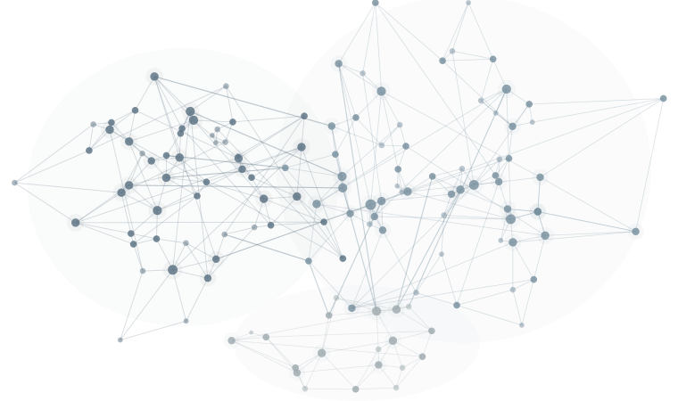
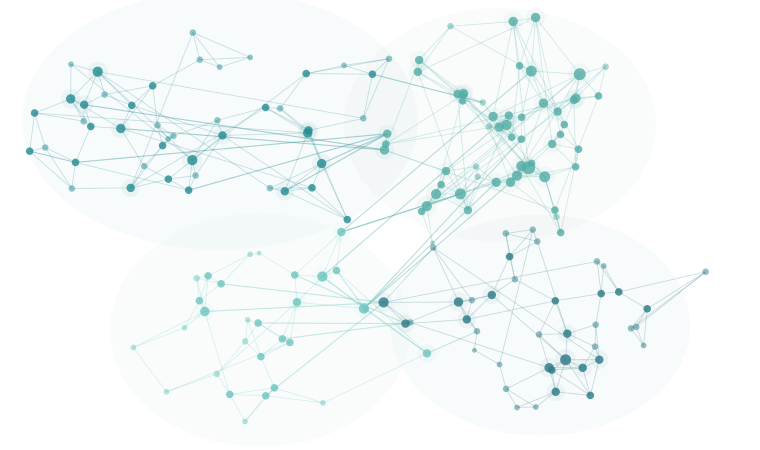
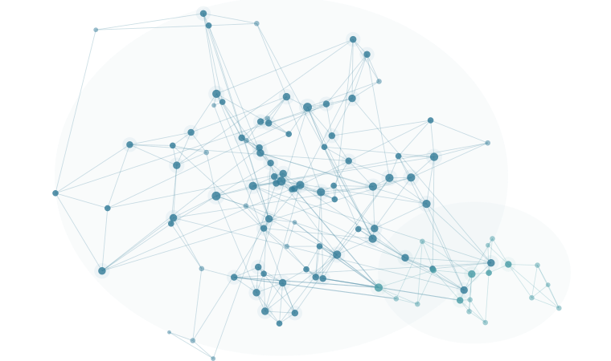

::: {.hero-section}
::: {.hero-inner}

NETWORK SCIENCE · COMPUTATIONAL RESEARCH

# Marcella Tambuscio {.hero-name}

Computational Humanities & Social Science

<a class="btn-primary-custom" href="research.html">Explore my research ↗</a><a class="btn-outline-custom" href="publications.html">View publications</a>

:::
:::

::: {.site-section .intro-section}

ABOUT ME

## A computational perspective {.section-heading}

I am a postdoctoral researcher at the University of Graz, with a background in mathematics and computer science. My research brings together network science, computational social science, and computational approaches to the humanities.

I am interested in how relationships shape social and cultural systems, and in how computational methods can help us investigate them. My work has ranged from modelling information diffusion, misinformation, and polarization in contemporary networks to reconstructing social and institutional relationships from historical sources.

My current research focuses on computational prosopography, historical network analysis, and the methodological challenges of representing and interpreting complex humanities data.

[Learn more about my research →](research.qmd){.text-link}
:::

::: {.site-section .research-section}

RESEARCH AREAS

<article class="research-card">

⌘

<h3>Computational Humanities</h3>

Computational prosopography, historical networks, knowledge representation, and data-driven approaches to humanities research.

<a class="text-link" href="research.html#computational-humanities">Explore this area ↗</a>

</article>
<article class="research-card">

✳

<h3>Computational Social Science</h3>

Information diffusion, misinformation, polarization, collective behaviour, and computational models of social systems.

<a class="text-link" href="research.html#computational-social-science">Explore this area ↗</a>

</article>

:::

<!--
::: {.site-section .projects-section}

CURRENT &amp; RECENT PROJECTS
<a class="text-link" href="projects/index.html">All projects →</a>

  <article class="project-card">
    
    <h3>Managing Maximilian</h3>
    
Reconstructing social relationships and communication networks around Maximilian I.

    <a class="text-link" href="projects/managing-maximilian.html">Explore project →</a>
  </article>
  <article class="project-card">
    
    <h3>Unlocking the Schematismus</h3>
    
Mapping Habsburg society and administrative structures through historical data.

    <a class="text-link" href="projects/schematismus.html">Explore project →</a>
  </article>
  <article class="project-card">
    
    <h3>Tartinians in Europe</h3>
    
Exploring musical networks around Tartini’s School of Nations.

    <a class="text-link" href="projects/tartinians.html">Explore project →</a>
  </article>

Network images are abstract illustrations; they do not represent project datasets.

:::

::: {.site-section .publications-preview}

SELECTED PUBLICATIONS
<a class="text-link" href="publications.html">All publications →</a>

2026
<strong>From Prosopography to Networks: Modelling Choices in Historical Knowledge Graphs.</strong> M. Tambuscio, S. Sagadin, R. Hadden, G. Vogeler · Accepted October 2026

2025
<strong>Bridging Semantics and Structure: a Typed Prosopographical Network of Maximilian I’s Court.</strong> M. Tambuscio, G. Vogeler · Anthology of Computers and the Humanities, 3, 131–141

2023
<strong>“#schleichdiduoaschloch” Terror, Collective Memory, and Social Media.</strong> M. Tambuscio, M. Tschiggerl · Social Media + Society, 9(3)

:::
-->

::: {.site-section .academic-community}

ACADEMIC COMMUNITY

I serve as **Vice Coordinator of the Historical Networks Research (HNR) Conferences and Workshops board**, alongside programme committee and scholarly event organisation activities.

[Academic service and CV →](cv.qmd){.text-link}
:::

::: {.site-section .closing-note}

GET IN TOUCH

## Interested in collaboration? {.section-heading}

I welcome conversations across network science, computational social science, and digital humanities.

[Email me →](mailto:marcella.tambuscio@uni-graz.at){.text-link}
:::
